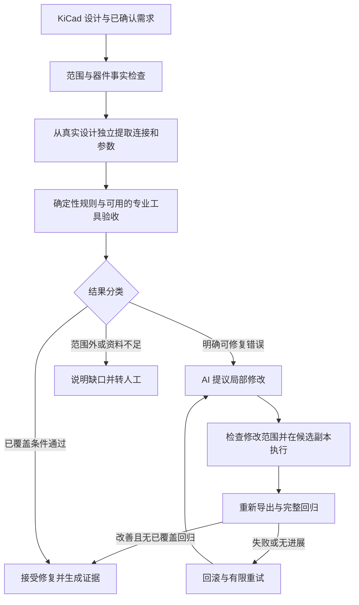

> ⚠️ INTERNAL — DEVELOPER FACING：本文件为竞赛内部材料（2026-09-06），仅面向 AEDL 开发者（Yenefa/Percy）。仓库转 public 或打包正式提交材料前必须移除，见 docs/competition/internal/INTERNAL_CLEANUP.md。

# AEDL 研究审查与架构判断

配套资料：[证据与阅读清单](<C:/Users/Ryan Gosling/Documents/Codex/2026-09-06/github-plugin-github-openai-curated-remote/outputs/AEDL_证据与阅读清单_2026-09-06.md>)。

研究日期：2026-09-06。提交目标：2026-10-12。团队：2 人，每周合计 30–45 人时。

**建议：优先申报 AI+开源，以电子设计开发工具为产品本体；将 AEDL 收敛为面向有限低压嵌入式电路的验证与受控修复工作台。先证明修复有效，再扩大生成能力。**

这项判断综合了用户提供的十篇论文、AEDL 当前代码、实际测试、公开项目源码与赛事官方规则。验证和修复值得成为核心，但它们本身已经是已有研究和产品的共同方向。AEDL 的竞争力需要来自具体错误覆盖、可执行修复、独立验收和可复现的效果。

**读取与结论边界**

- 十篇 PDF 的正文和附录均已读取，共 226 页；对影响判断的表格、代码示例另做了页面视觉核对。论文文件清单、版本和指纹见配套证据清单。
- AEDL 基准为 `master@c1d6d72eb21cad7eafea214197c756495a4566c0`。已做整库盘点，重点审查生成、门禁、语义、需求、编排、证据与固件路径；大型生成文件按结构、关键字段和关联证据检查。这不是每行代码、每个几何对象均已证明正确的声明。
- 补查了主仓引用的 `AEDL-spike@e8ce045adff2e6fb9cf87416e85a076af6669c67`。未合并 PR 与实验仓库的成果不计作主仓已集成能力。
- 本轮没有修改核心代码、发布仓库、提交 PR、下单或制造放行。额外执行的文件修改仅发生在研究用隔离副本。
- 主仓测试与 akcli 有限操作试验有本次执行记录；真实 KiCad 原生检查、SPICE、电路板运行及论文完整实验未在本次复现。

**1. 对当前研究领域的整体判断**

这一组论文覆盖了四类不同问题：板级原理图生成与审查、固定器件位置的 PCB 布线、RTL 生成与修复、芯片物理设计优化。可迁移的是工具反馈、问题分解、局部修改和验收方法；不能直接迁移的是各领域的成功率及其正确性含义。

| 论文 | 对 AEDL 有价值的结论 | 必须保留的边界 |
|---|---|---|
| PCBSchemaGen | 器件事实、确定性图规则和定位明确的反馈，可以显著改善生成结果；同为最多 4 次调用，独立采样 60.54%、简单修复 78.40%、Thompson Sampling 81.29%，说明先做好简单闭环很值得 | 受限器件库及结构性验收；Pass@1 是一次最多 4 次调用的轨迹；不等于整板电气性能或制造可靠性 |
| DRCY | 数据手册获取、按电路功能分组、把问题归并到根因，适合工程审查 | 五页论文没有提供受控准确率、召回率或修复闭环实验；多模型共识仍可能共同判断错误 |
| PCBWorld | 真实 EDA 环境和可执行反馈很重要；交互式工具使用优于只生成布线计划 | 固定布局布线任务；中等板上被测 LLM 的完成率仍为 0%，不能据此承诺通用自动布线 |
| CircuitLM | 限定器件范围和清晰中间表示有用 | ERC 与模型评审得分明显分离；未完成仿真与修复闭环，模型评审不等于功能真值 |
| SchGen | 使用语义引脚和相对位置的接口，比直接生成冗长 KiCad 文件更适合模型 | 专家功能评估仍有较大失败比例；分布外结果不支持直接搬用微调模型解决 AEDL |
| AutoChip | 固定验收、有限预算、编译/仿真反馈与候选保留是成熟方法 | 反馈对不同模型的收益不同，必须与同预算重新采样比较 |
| VeriSure | 局部定位、切片、补丁和回滚值得迁移 | 93.30% 是所用测试集的功能通过率；形式证明主要针对局部组合逻辑，断言与规格也可能错误 |
| HWE-Bench | 由人建立独立测试条件、区分静态与动态验收，非常适合借鉴 | 是板级 benchmark，不能与同名 RTL benchmark 混淆；对应代码/数据尚未核实可获取 |
| PostEDA-Bench | 修一个约束可能破坏另一个约束，修复必须做完整回归；复杂多 Agent 并不稳定优于简单方法 | 面向 IC 物理设计；DRC 任务没有 LVS，不能把几何规则通过当作连接等价 |
| EDAid | 结构化工具接口、少量候选探索具有工程价值 | 脚本任务成功不等于硬件产品可交付；训练大模型和模型裁判不是当前最划算的投入 |

整体判断是：**目前最成熟的进展，是在明确范围与验收条件下，提高设计任务的完成率；距离任意电子设计的可信交付仍有很大差距。** 十篇论文构成选定研究样本，不代表已穷尽全球全部工作，也不支持宣称全球领先。

**2. 对 AEDL 当前状态的评价**

AEDL 已经积累了有价值的工程约束和失败教训，但控制流程、证据文件与治理机制的完成度，领先于真实设计执行闭环。

| 本次核查 | 实际结果 | 可支持的判断 |
|---|---|---|
| 主仓单元测试 | 322 项通过 | 已有相当数量的软件回归控制 |
| sandbox 测试 | 283 项；1 个错误、1 个跳过、1 个预期失败 | 编排与策略机制有测试，但不能称全绿；错误发生于 Windows junction 测试准备阶段，不是已证明的路径逃逸 |
| EDD-001 真实预检 | BLOCKED，8 项缺口 | 器件资料、可用合同、编译器注册与验证覆盖未闭合 |
| sandbox 执行/验证/修复适配器 | 当前演示为 TEST_ONLY；尝试次数达到 2 即通过 | 证明循环机制，不证明电路修复能力 |
| akcli 0.21.0 隔离试验 | 读取 M2、修改参数、重复执行、拒绝错误合网、按备份恢复均取得实际结果 | 存在可优先复用的文件操作通道；尚不是 LLM 修复或独立电路验收 |

影响架构决策的主要发现：

- **真实的共同错误已经发生过。** USB 信号身份、SHT30 地址等错误曾在意图、原理图和 PCB 之间保持一致，旧 ERC/DRC 和板级检查仍通过。说明“多份文件一致”不能代替“独立工程事实正确”。[事故记录](https://github.com/Yenefa/AEDL/blob/c1d6d72eb21cad7eafea214197c756495a4566c0/docs/knowledge/PROJECT_PITFALLS.md)
- **检查名称有时比实际测量范围更强。** 地回流检查主要检查过孔数量和铺铜存在；热检查主要检查距离；去耦检查主要检查共享电源网络与距离。这些可以保留为筛查指标，不能升级为完整回流、热或电源完整性证明。[板级检查](https://github.com/Yenefa/AEDL/blob/c1d6d72eb21cad7eafea214197c756495a4566c0/tools/board_review.py#L321)
- **生成链仍存在重新引入旧错误的风险。** `build_board.py` 的 U3 映射仍是 SOT-23-5，当前设计采用 SOT-353。该调用路径存在静态不一致，本轮没有执行重建。通用生成能力不能从固定 M2 脚本的存在推导出来。[映射](https://github.com/Yenefa/AEDL/blob/c1d6d72eb21cad7eafea214197c756495a4566c0/tools/build_board.py#L15)
- **U3 电源问题尚未闭合。** 不能仅把候选换成 AMS1117 就视为解决，需要核对实际负载、输入范围、温升、稳定性及封装条件。本轮不替团队批准器件替换。
- **部分文档已经过时。** 旧 M2 报告仍有放行表述，而当前正式文件 `manufacturing_release=false`；Web README 仍称服务端不存在，但仓库已有服务端代码；开放成果文件称没有 LICENSE，而当前主仓已有 Apache-2.0。应由当前状态索引统一对外表述。
- **“信任”边界没有完全落地。** 内容哈希能识别内容变化，但不能单独证明是谁执行、谁批准。PR #34 是进一步设计，不能宣传为已完成的强隔离执行系统。
- 实验仓库已有“宿主机测试→预设补丁→回滚→目标仿真”的历史记录，但补丁候选和部分诊断文本是预设的；它适合复用 runner 和评测方法，不应计作自主 AI 诊断能力。

**3. AEDL 应如何重新定位，以及更适合哪个赛道**

建议产品定义：**AEDL 电子设计验证与修复工作台——帮助低压嵌入式开发者发现设计中的具体错误，提出受约束的局部修改，并用独立检查与可追溯结果验收。**

目标用户先限定为使用 KiCad 的学生团队和小型嵌入式开发团队；首个问题限定为器件引脚、接口连接、元件参数以及硬件—固件配置的一致性。输入既可以来自 AI，也可以来自人工。原理图生成保留为可选入口。

按主仓指向的 2026 AIC 官方规则，在用户给出的两个方向中，**优先 AI+开源，主要方向选“AI 开发工具与开源协作”**。这是赛道匹配判断，不是对参赛资格的裁定。

| 评委会辨认的产品与贡献 | AI+硬件创新 | AI+开源 |
|---|---|---|
| 主要评价对象 | 智能硬件产品及其算法作用、实测性能、稳定性 | AI 与开源资源融合形成的工具、流程及可复用成果 |
| AEDL 目前的对应资产 | M2 是设计与验证的对象，尚缺完整实测与硬件产品差异化 | KiCad 工具集成、约束检查、修复流程、测试与证据资产直接对应 |
| 最可能的追问 | 硬件产品本身创新在哪里？AI 怎样改善其功能与性能？ | 相比现成工具与脚本组合，团队到底增加了什么？别人能否复现？ |
| 达到有说服力演示的新增负担 | 硬件稳定性、应用场景与 AI 功能需要同时成立 | 接通真实修复、做独立对比实验、整理可复用成果 |

硬件规则允许调用在线算法或大模型，因此我的理由并非“AI 必须在板上运行”。关键在于 AEDL 的产品本体是设计开发工具，电路板主要用于验证工具的效果。若未来产品转成带测量硬件、能自动执行测试并据此调试的实体台架，且台架自身有实测优势，硬件赛道的匹配度才会显著提高。[硬件赛道官方规则](https://www.aicomp.cn/tracks/tracks-2/3797.html)

开源赛也不能靠“使用了 Python、KiCad 和一个模型接口”拿到强评价。需要展示团队新增的约束表达、跨产物验收、修复控制或可复现测试，如何实际改善流程。[开源赛官方定位](https://www.aicomp.cn/tracks/tracks-5/4924.html)

**4. 推荐的系统架构与核心能力**

建议采用一个负责诊断与补丁提议的模型角色，配合确定性的工具执行与验收；不默认建立多人格 Agent 团队。

核心分工如下：

- **器件事实目录：**精确型号、封装、引脚身份、单位、允许范围、适用条件，以及资料页码与版本。关键事实先由人校核一次，再按版本复用；模型抽取结果只是待审候选。
- **设计状态：**从当前真实文件读取。符号、封装、网表、PCB 和固件各保留来源，不以同一个生成意图代替所有观察结果。
- **验收条件：**与候选生成过程分离。参考厂家资料、确认的需求和独立测试；生成 Agent 不能修改期望值、关闭规则或添加免责例外。
- **修改执行：**补丁必须指定基准版本、目标对象、前置条件和获准变化。优先使用 akcli 现有操作，不开放任意脚本重写整板。
- **修复验收：**重新读取文件、核对目标变化、检查受保护关系，并重新运行全部适用检查。合法修复可能需要改变网络，因此要比较预期与实际网络变化，不能简单以“所有网络变化都拒绝”代替控制。
- **结果：**区分 PASS、FAIL、UNKNOWN、NOT_RUN、TOOL_ERROR 和有明确理由的 NOT_APPLICABLE。零覆盖不算通过。

必须区分两种结论：**“这次局部修复被接受”**与**“整板满足制造或实物使用条件”**。USB 修复成功时，如果电源温升仍未确认，前者可以成立，后者仍应阻断。

对现有概念的取舍：Design Contract 保留其中可检查的需求与事实，取消无理由的统一七天过期；将冻结验收标准和候选版本绑定分开，避免每次获准修复都重新问用户。Verification Layer 保留其职责，但公开覆盖范围。Repair Agent 作为补丁提议者。LangGraph 保留作编排工具，暂不迁移框架，也不作为创新点。

**5. 当前仓库哪些资产可以继承**

| 资产 | 继承方式 |
|---|---|
| M2 KiCad 工程、意图、固件及历史失败快照 | 用作首个受限案例和故障来源；先修正文档状态与设计基线 |
| `schematic_semantics.py` 与独立采集四个视图的思路 | 保留并逐步从固定 Ref/网名判断改为器件角色与真实引脚关系 |
| `run_gates.py` 的新鲜导出、失败关闭、输出关联 | 保留执行机制；明确哪些结果来自原生工具，哪些是项目规则 |
| `export_delivery.py`、BOM/CPL 转换与一致性检查 | 直接继承已有工程价值，尤其是防止多个陈旧文件同时“自洽通过” |
| 回归测试与真实事故记录 | 转成有限、独立标注的故障集，包含正确设计与合法替代设计 |
| sandbox 状态机、预算、停滞检测、回滚/恢复接口 | 在接入成本低时保留；替换测试夹具适配器，不继续扩建控制平台 |
| 实验仓库 verification runner、预设补丁循环 | 作为测试执行与确定性修复基线；明确历史证据与本次复现的区别 |
| Web 需求界面、API 与报告素材 | 选择性复用；比赛主界面应直接显示错误、修改、验收与剩余问题 |

固定坐标的板生成脚本、字符串关键词约束和数量/距离启发式均需保留其范围标记，不应直接包装成通用电子工程引擎。

**6. 哪些论文代码与开源资产值得复用**

优先顺序按减少交付风险排列，许可证信息是本次读取到的项目文件事实，不替代后续具体再分发审查。

| 资产 | 已核对的可用性 | 建议 |
|---|---|---|
| akcli-kicad 0.21.0 | PyPI 发布包、SHA256、MIT 文件已核对；隔离副本操作试验完成 | 第一优先作为原理图读取/修改适配器；另外调用 KiCad 做独立验收 |
| KiCad CLI | 官方接口支持网表、ERC、DRC 与制造物导出 | 锁定单一可复现版本作为原生验收；不要把 KiCad 9/10 IPC 当作现成无界面原理图后端 |
| PCBSchemaGen_v2 | MIT；公开验证器和 benchmark，不含完整论文生成循环 | 复用图关系表达、规则定位与事实结构；改造输入适配和任务特例 |
| SchGen | MIT；语义操作接口和数据流程可读取 | 只在 akcli 无法满足必要操作时评估接口；先处理模糊匹配、封装默认值与共享状态 |
| AutoChip / Veri-Sure | 分别核对到 Apache-2.0 / MIT | 主要迁移有限搜索、定位和局部补丁方法，不引入 RTL 工具栈 |
| PostEDA-Bench | 可读公开实现，仓库 LICENSE 为 CC BY 4.0 | 借鉴分层故障、全回归和多目标评测，不引入芯片物理实现流程 |
| CircuitLM / ChatEDA | MIT / Apache-2.0 | 参考器件范围、工具 API 和例子；不默认具备论文完整端到端能力 |
| PCBWorld | 自定义 PCBWorld 1.0-NC 条款，含非商业及额外限制 | 本期不引入核心实现，以方法参考为主 |
| DRCY / 所提供 HWE-Bench | DRCY 为商业系统；未核实前者可复用源码及后者匹配的代码/数据 | 不列入计划中的现成软件依赖 |

关键来源：[akcli](https://pypi.org/project/akcli-kicad/0.21.0/)；[KiCad CLI](https://docs.kicad.org/10.0/en/cli/cli.html)；[KiCad IPC 边界](https://dev-docs.kicad.org/en/apis-and-binding/ipc-api/for-addon-developers/index.html)；[PCBSchemaGen](https://github.com/HZou9/PCBSchemaGen_v2)；[SchGen](https://github.com/microsoft/SchGen)。

ngspice 可作为小电路的补充验收，但只在模型和测试条件已明确时接入，例如 RC 响应或有可信模型的简单电源。不要把整块 ESP32 板的功能验证建立在尚不存在的完整 SPICE 模型上。[ngspice 控制流程](https://ngspice.sourceforge.io/ngspice-control-language-tutorial.html)

**7. 哪些能力应该新做**

必须新做的是把现有资产接成真实闭环，而不是增加抽象层：

1. 选定一组器件与电路模式，形成可检查、可审阅的适用范围与事实目录。
2. 为现有操作工具提供薄适配器，把受约束补丁作用到候选文件，再取得独立新证据。
3. 生成简洁的错误反馈：涉及哪些引脚、哪个约束、实际与期望差异、可编辑范围。
4. 实现预算内的真实模型补丁提议；默认最多 3 次候选，停滞或范围扩展则退出。
5. 建立独立验收集与基线，量化模型到底增加了什么。

第一版评测建议 24 个案例：12 个单故障、4 个组合故障、4 个正确/合法替代设计、4 个资料不足或范围外案例。来源覆盖一个主板案例及有限模块变体，并保留未参与调试的变体。故障施加在真实设计文件上，不能只修改观察结果 JSON。

比较至少包括：确定性已知修复、同预算无反馈重新提议、原始工具日志反馈、定位后的受控修复。昂贵模型的重复实验可以先限于一部分代表案例；至少明确模型版本、调用上限、工具调用、耗时、失败退出和全部分母。

主要结果应报告：目标错误修复数、最终无已覆盖回归的成功数、误放行、误报、转人工、未覆盖项、成本和耗时。基准验收由另一名成员依据独立事实核对；测试本身也应接受故障注入和合法变体检验。小样本的零误放行不能宣传成普遍零风险。

**8. 哪些功能应该砍掉或延后**

- 任意自然语言需求到任意 PCB 的通用生成承诺。
- 自研自动布局布线、强化学习训练、PCBWorld 全环境集成。
- 大模型微调、广覆盖自动资料知识图谱、多 Agent 人格扩张。
- 本轮的新身份认证平台、复杂签名体系、框架迁移与大范围治理重构。
- 把实时供应链搜索作为每次修复的必经路径；供应链属于适用的交付检查。
- 用大模型投票决定电气真值，以及整板 SI/EMI/热可靠性保证。
- 为了贴合硬件赛道，临时另做一个与核心工具无关的 AI 硬件产品。

保留必要的人为范围控制和版本证据；减少反复确认、七天统一过期和多层重复声明所带来的摩擦。

**9. 10 月 12 日前最值得投入的方向**

按 36 天计算，团队名义容量约 154–231 人时。应按低端制定承诺，新增容量用于强化验证，不提前消耗在功能清单中。建议以约 150 人时为基线：

| 工作包 | 计划人时 | 可验收结果 |
|---|---:|---|
| 范围、器件事实、M2 基线与状态整理 | 18 | 已知错误、未知条件、允许修复与验收条件清楚 |
| 原生文件适配与新鲜导出 | 24 | 单个真实修改能重新读取、独立检查并按版本回滚 |
| 2–3 类检查、定位与 AI 修复 | 36 | 模型实际提出并执行补丁；正确失败退出 |
| 24 案例与基线比较 | 24 | 固定案例、独立期望、全量结果与成本 |
| 展示、复现说明、报告与视频 | 26 | 另一台机器可复现，3–5 分钟演示清楚 |
| 集成与不确定性缓冲 | 22 | 处理工具、数据、模型与环境问题 |
| 合计 | 150 | 完成一个可验证的小系统 |

建议你负责主链路与模型适配，另一名成员负责器件事实、独立案例与验收；双方交叉复核。不要让同一个人只根据自己生成的设计编写全部判定条件。若对方硬件背景不足，需要缩小电路范围，而不是让 AI 自行批准资料。

时间安排：9 月 7–12 日建立一个真实修改与验收闭环；9 月 13–20 日完成 2–3 类修复与初步案例；9 月 21–27 日完成独立评测、合法变体与基线；9 月 28 日–10 月 4 日用于实测补证、复现与冻结；10 月 5–11 日集中展示与材料，12 日提交。

实板与 SPICE 是有价值的增强项，但不能同时成为多个未闭合依赖。若有额外工时和现成设备，优先补一个实际供电/启动/I2C 测量案例。若电源设计或实板尚未确认，继续明确 BLOCKED，不以视频掩盖。

官方开源赛页面目前列出初赛截止为 2026-10-15 20:00，本计划仍遵守用户的 10 月 12 日目标。[官方赛程](https://www.aicomp.cn/notice/notice-3/4890.html)

**10. 比赛中最有说服力的创新叙事**

建议叙事：**把 AI 生成电子设计中的具体错误，转化为可定位、可执行修改、可独立复核的工程过程，并把修改与固件、制造文件及验证证据保持一致。**

不要宣称首次闭环、首次拒绝或首次设计合同。PCBSchemaGen、DRCY、KiCadAI、akcli 等已有相关能力。尤其 KiCadAI 当前文档已包含范围判断、验证、重放与澄清回答流程，主仓旧竞品笔记不能继续作为不存在这些能力的证据。[KiCadAI](https://github.com/dshills/KiCadAI)

最有说服力的演示顺序是：展示一个旧基础检查未捕获的具体错误；指出独立依据；让模型提出可见的局部补丁；真实应用并重新验收；显示所有受保护检查；最后展示一个因资料不足而正确转人工的案例。附全量评测结果，使观众知道成功例子不是唯一可运行输入。

若只播放预设补丁脚本，即使能回滚，也只能证明流程自动化。需要用未参与调试的输入和确定性基线，说明 AI 在错误解释或修复提议中带来的具体收益。

官方开源赛权重为问题价值 15、创新与方案 20、AI 与开源融合 20、实现与可验证效果 25、开放复用 15、材料表达 5。最应投入的对应证据是：真实案例、团队新增机制、工具与 AI 的分工、独立对比结果、可运行的开放成果。完整度同分优先，进一步支持“小范围做实”的策略。[官方评分附件](https://www.aicomp.cn/wp-content/uploads/2026/08/%E9%99%84%E4%BB%B61_AIC%C2%B7AI%E5%BC%80%E6%BA%90%E7%AB%9E%E8%B5%9B%E8%A7%84%E5%88%99%E5%8F%8A%E4%BD%9C%E5%93%81%E6%8F%90%E4%BA%A4%E8%A6%81%E6%B1%820812.pdf)

**11. 最大技术风险与答辩风险**

| 风险 | 评委可能追问 | 应准备的证据或处理 |
|---|---|---|
| 验证器与设计共享错误假设 | 谁证明你的验收条件正确？ | 厂家事实、独立案例、合法替代设计、验证器自身的负向测试 |
| 实际能力局限于 M2 | 换网名、换编号、换允许的器件还能工作吗？ | 保留结构等价变体、范围清单和未参与调试的案例 |
| 规则通过被夸大为物理正确 | 通过之后板子一定能工作吗？ | 分开说明结构、功能、实测与制造证据，展示未知项 |
| AI 贡献薄弱 | 这些修复用固定脚本是否更好？ | 与确定性修复比较；简单确定问题继续用脚本，只为 AI 的实测增益主张贡献 |
| 现成工具已有类似能力 | 你们是否只是封装 akcli？ | 明确团队新增的跨视图验收、获准变更控制、故障集和实验结果 |
| 工具版本、封装与文件更新造成回归 | 改完一个问题，其他文件是否仍一致？ | 版本锁定、精确引脚/封装身份、全回归、导出时间与源哈希关联 |
| 许可证或开放成果不清楚 | 哪些能合法复用、哪些是团队完成？ | 按实际采用的代码记录版本与边界；开放可复现脚本/案例，避免搬运无权再分发的数据 |
| 工时与实板不确定性 | 系统是否只在演示机器上运行？ | 第二台机器复现、固定版本、失败演示与时间缓冲 |

此外，论文不是免审的权威：本次发现 VeriSure 附录部分时序描述和断言示例存在具体问题，HWE-Bench 的静态/动态对比文字与表格不一致。这不推翻论文全部实验，但要求团队自己理解每条迁移规则，而不是引用论文标题替代证明。

**12. 后续实施优先级与停止条件**

1. **P0：冻结可验收范围。** 一个主案例、明确器件、2–3 类修复；核对 M2 当前状态与 U3 未决问题；确认哪些结果仅是局部修复验收。
2. **P0：接通一个真实修复。** 优先 akcli 0.21.0，补 KiCad 新鲜独立导出；证明目标修改、受保护关系与按基准版本恢复。先完成此项，再扩展 Agent 能力。
3. **P1：建立事实与验收。** 分离模型提议、工程事实、实际观察与测试期望；模型不可修改验收文件。
4. **P1：建立公平评测。** 24 个案例、确定性及同预算模型基线；每个失败和转人工均记录，不只统计最终成功。
5. **P1：完成复现与展示。** 从另一台机器运行，开放团队可提供的适配、测试和说明，明确上游与自研边界。
6. **P2：有余力再补实物或小电路仿真。** 前提是模型、设备与测试条件真实可用，不拖延主闭环。

停止条件：若首周无法稳定完成一个原生文件修改与独立验收，立即削减自动生成与 PCB 几何修改范围；若同预算实验显示 AI 对已知错误没有收益，就保留确定性修复，把 AI 用于有证据支持的诊断或新变体提议；若目标范围过宽导致事实与模型无法闭合，收缩器件与电路类别。

本轮完成的是研究判断和可复核的实施建议。以上新增系统能力、评测规模和里程碑均为后续建议，不是当前完成状态。
